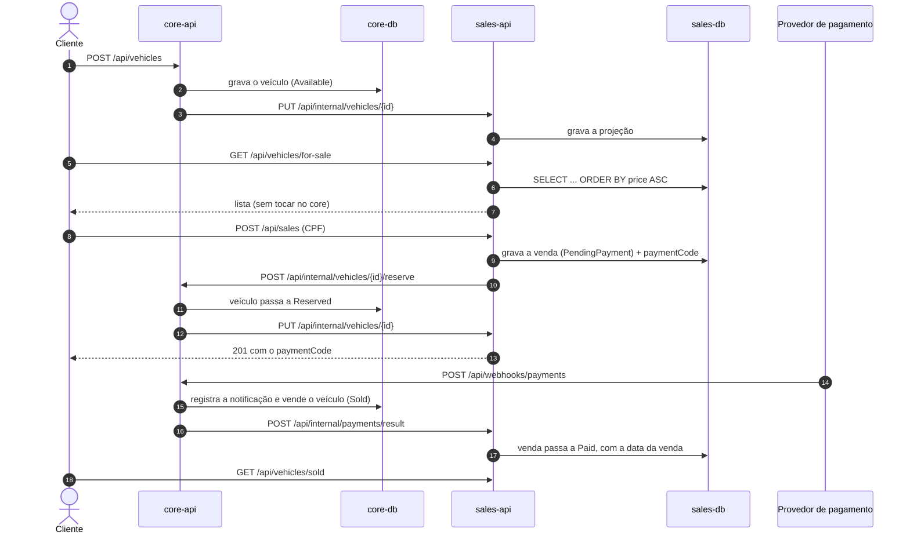

# Plataforma de Revenda de Veículos — FIAP SOAT / Pós-Tech

Trabalho substitutivo do Tech Challenge — Fase 4. Backend da plataforma de uma revenda de
veículos, dividido em **dois serviços independentes, com dois bancos de dados isolados**, que
conversam exclusivamente por **HTTP**.

| Serviço | Pasta | Porta local | Banco | Responsabilidade |
|---|---|---|---|---|
| **core** | [`core/`](core) | `8080` | `core-db` (`fiapsub_core`) | Catálogo de veículos (cadastro, edição) e recebimento do **webhook de pagamento** |
| **sales** | [`sales/`](sales) | `8081` | `sales-db` (`fiapsub_sales`) | **Listagens públicas** ordenadas por preço e **efetivação da compra** |

O enunciado exige que *"os endpoints de listagem e compras de veículos estejam isolados em um
serviço único, rodando com um banco de dados isolado"*, para suportar aumento repentino de
chamadas. É exatamente essa a divisão acima: o `sales` atende todo o tráfego público lendo o
**próprio** banco, e escalar o `sales` não gera carga no `core`.

---

## Como rodar localmente

Pré-requisitos: **Docker** e **Docker Compose**. Nada mais — o .NET só é necessário para rodar os
testes fora do container.

```bash
docker compose up --build        # sobe core-db, core-api, sales-db e sales-api
./scripts/e2e.sh                 # exercita a solução ponta a ponta
```

- Swagger do core: <http://localhost:8080/swagger>
- Swagger do sales: <http://localhost:8081/swagger>

O `scripts/e2e.sh` é o roteiro do vídeo de demonstração: ele cadastra veículos, lista por preço,
compra, dispara o webhook de pagamento, confere a venda efetivada e também os caminhos negativos
(pagamento cancelado, compra duplicada, webhook repetido, rota interna sem token).

```bash
docker compose down              # para tudo, preservando os dados
docker compose down -v           # para tudo e zera os bancos
```

> Os volumes são nomeados e persistem entre execuções. Como o webhook é idempotente *para sempre*
> (há um registro permanente por código de pagamento), rode `docker compose down -v` quando quiser
> um estado limpo.

### Provando que os bancos são realmente separados

```bash
docker compose exec core-db  psql -U fiapsub -d fiapsub_core  -c '\dt'
docker compose exec sales-db psql -U fiapsub -d fiapsub_sales -c '\dt'
```

O `core-db` tem apenas `vehicles` e `payment_notifications`. O `sales-db` tem apenas `sales` e
`vehicle_snapshots`. Cada um com o seu próprio `__ef_migrations_history`. Não existe conexão
cruzada: a única via entre os serviços é HTTP.

---

## Como testar

```bash
dotnet test --solution core/FiapSub.Core.slnx
dotnet test --solution sales/FiapSub.Sales.slnx
```

Com relatório de cobertura (o mesmo caminho que o CI executa):

```bash
dotnet test --solution core/FiapSub.Core.slnx \
  --coverage --coverage-settings coverage.runsettings \
  --coverage-output-format cobertura --coverage-output coverage.cobertura.xml

dotnet tool install --global dotnet-reportgenerator-globaltool
reportgenerator -reports:"core/tests/**/TestResults/coverage.cobertura.xml" \
  -targetdir:coveragereport -reporttypes:"Html;TextSummary"

cat coveragereport/Summary.txt
```

Os testes de integração sobem um PostgreSQL de verdade via **Testcontainers** e aplicam as
migrations do EF Core — ou seja, as migrations versionadas também estão sob teste. É preciso ter o
Docker em execução. Para rodar só os testes que não dependem dele:

```bash
dotnet test --solution core/FiapSub.Core.slnx --filter-not-trait "Category=Integration"
```

### Cobertura atual

| Solução | Testes | Cobertura de linha |
|---|---:|---:|
| `core` | 172 | 99,8% |
| `sales` | 197 | 100% |

O mínimo exigido é 80%, e o pipeline falha abaixo disso.

---

## Arquitetura

### Fluxo da compra, ponta a ponta



### Por que o `sales` replica os veículos

O `core` é a **única fonte de verdade** do veículo. Ainda assim, o `sales` mantém uma cópia
(`vehicle_snapshots`) alimentada por push HTTP a cada mudança. Sem isso, cada requisição de
listagem viraria uma chamada ao `core`, e o isolamento pedido no enunciado não existiria na
prática.

A replicação é segura porque:

- cada veículo carrega um `Version` que o agregado incrementa a cada mudança;
- o `PUT /api/internal/vehicles/{id}` **ignora** qualquer push com versão menor ou igual à que já
  possui, então reenvios e chegadas fora de ordem não corrompem a listagem;
- `POST /api/internal/catalogue/sync` no `sales` puxa o catálogo inteiro do `core` e reconcilia o
  que algum push tenha perdido — é também como uma instalação nova preenche as listagens.

### A compra é uma saga com compensação

A compra atravessa os dois serviços, então não existe transação única. A ordem é deliberada:

1. o `sales` grava a venda **primeiro** — nunca se reserva um veículo sem haver registro do motivo;
2. pede ao `core` para reservar o veículo;
3. se o `core` recusar, a venda é cancelada;
4. se o `core` **não responder**, a reserva pode ter sido efetivada antes da queda — então o
   `sales` cancela a venda **e** chama `POST /api/internal/vehicles/{id}/release` por precaução.

Toda chamada entre serviços usa `Microsoft.Extensions.Http.Resilience` (retry, timeout e circuit
breaker), ou seja, é **at-least-once**. Por isso todo endpoint receptor é idempotente:

| Operação | O que a torna idempotente |
|---|---|
| Webhook de pagamento | índice único em `payment_notifications.payment_code`: o replay encontra a notificação já registrada e nada muda |
| Reserva do veículo | reservar com o **mesmo** `paymentCode` é no-op no agregado |
| Push da projeção | só aplica versão estritamente maior |
| Resultado do pagamento | `MarkPaid`/`Cancel` são no-op quando a venda já está no estado final |
| Compra duplicada | índice único parcial `ux_sales_pending_vehicle` (`WHERE status = 'PendingPayment'`) |

### Segurança das rotas internas

As rotas `/api/internal/*` dos dois serviços são protegidas pelo header compartilhado
`X-Internal-Token`, comparado em tempo constante. O padrão é **fail closed**: sem token
configurado, essas rotas respondem `503` em vez de ficarem abertas. No Kubernetes elas ficam fora
do Ingress — só são alcançáveis pelo `Service` interno do cluster.

---

## Como foi implementado

**Clean Architecture em camadas, cada camada uma biblioteca C# separada**, com o padrão de nome
`<projeto>.<camada>.<subcamada>` pedido em [`docs/specs.md`](docs/specs.md):

```
core/src/
  FiapSub.Core.Domain                      agregados, value objects, eventos, interfaces de repositório
  FiapSub.Core.Application                 casos de uso, Result, validações, contratos de gateway
  FiapSub.Core.Infrastructure.Database     EF Core: DbContext, mapeamentos, repositórios, migrations
  FiapSub.Core.Infrastructure.Http         HttpClient tipado para o serviço de vendas
  FiapSub.Core.Api                         controllers, middlewares, health checks, Swagger
```

A dependência entre camadas é imposta pelas **referências de projeto**: o `Domain` não referencia
nada — nem projeto, nem pacote. `Api -> Application -> Domain`,
`Infrastructure.* -> Application -> Domain`, e o `Api` só conhece a infraestrutura no ponto de
composição.

### DDD

- **Agregados** com invariantes dentro do próprio objeto: `Vehicle`, `PaymentNotification` (core),
  `Sale`, `VehicleSnapshot` (sales). Não há setter público — toda mudança passa por um método de
  comportamento (`Reserve`, `ConfirmSale`, `MarkPaid`, `Cancel`…).
- **Value objects**: `Money`, `ModelYear`, `PaymentCode` e `Cpf` (com validação dos dois dígitos
  verificadores). Um CPF errado não chega ao banco.
- **Eventos de domínio** coletados no agregado e despachados pelo `UnitOfWork` **depois** do
  commit, de modo que nenhum handler reaja a uma mudança desfeita — e uma falha de push nunca
  derruba a requisição, porque o estado já foi gravado e a reconciliação existe.
- **Dois bounded contexts**: as peças comuns (`Money`, `PaymentCode`, bases de agregado) são
  duplicadas de propósito, uma em cada serviço. Uma biblioteca compartilhada acoplaria os dois
  modelos e impediria que evoluíssem separadamente.

### Persistência — EF Core (code-first)

Única tecnologia de acesso a dados: **nada de Dapper, ADO.NET cru ou SQL escrito à mão**.

- um `DbContext` por serviço, com `DbSet` apenas para raízes de agregado;
- um `IEntityTypeConfiguration<T>` por agregado — o `Domain` não tem data annotations nem qualquer
  referência ao EF;
- value objects mapeados por `ComplexProperty` (`Money` → `price` + `price_currency`) e por
  `HasConversion` (`Cpf`, `PaymentCode`, `ModelYear`), enums como texto;
- concorrência otimista pelo `Version` do próprio agregado (`IsConcurrencyToken`), que vira `409`;
- índices que sustentam regras e consultas: únicos em `payment_code`, único parcial de venda
  pendente por veículo, e `(status, price)` para as duas listagens ordenadas;
- **migrations versionadas**, aplicadas com `Database.MigrateAsync()` no start quando
  `Database:RunMigrationsOnStartup` está ligado. `EnsureCreated` não é usado em lugar algum.

### Tratamento de erros

| Situação | Resposta |
|---|---|
| Entrada inválida (FluentValidation) | `400` com `ProblemDetails`, `code: validation.failed` e os erros por campo |
| Invariante de domínio violada | `400` (`DomainValidationException`) |
| Transição de estado impossível | `409` (`DomainStateException`) |
| Conflito de concorrência / unicidade | `409` (`DbUpdateConcurrencyException`, `DbUpdateException`) |
| Recurso inexistente | `404` com um `code` estável (`vehicle.not_found`, `sale.not_found`…) |

Falhas esperadas trafegam como `Result`/`Error` entre as camadas; exceção fica reservada para o
que é realmente excepcional.

---

## CI/CD

[`.github/workflows/core.yml`](.github/workflows/core.yml) e
[`.github/workflows/sales.yml`](.github/workflows/sales.yml), filtrados por pasta:

- **`pull_request`** → restore, build com `-warnaserror`, testes com cobertura, relatório e
  **falha abaixo de 80%** de cobertura de linha. O relatório HTML fica como artefato para download
  (é a evidência de cobertura pedida para o vídeo).
- **`push` na `main`** (isto é, merge de um PR) → o mesmo gate, build da imagem, publicação no
  **GHCR** e `kubectl apply` dos manifests, seguido de `kubectl set image` apontando para a imagem
  daquele commit e `rollout status`.

O deploy é, portanto, **disparado por Pull Request com gatilho no merge na branch principal**, como
o enunciado pede. O passo de `kubectl` é condicionado ao secret `KUBE_CONFIG` (kubeconfig em
base64): sem cluster configurado ele é **pulado, não falha**, e o resumo do run diz isso
explicitamente.

Para proteger a `main` no GitHub: *Settings → Branches → Add rule* exigindo PR e o check
`Build and test` aprovado.

### Kubernetes

`core/k8s/` e `sales/k8s/` trazem, cada um, o conjunto completo de publicação:

| Arquivo | Conteúdo |
|---|---|
| `namespace.yaml` | namespace `fiap-sub` |
| `configmap.yaml` | configuração não sensível (`Database__*`, URL do outro serviço) |
| `secret.example.yaml` | **modelo** de secrets — connection string e token compartilhado |
| `postgres.yaml` | `StatefulSet` + `Service` do banco **próprio** do serviço, com volume |
| `deployment.yaml` | **Deployment** da API: 2 réplicas, rolling update, probes, limites, não-root, root FS read-only |
| `service.yaml` | **Service** `ClusterIP` |
| `hpa.yaml` | autoscaler por CPU (2–10 réplicas) — é a resposta ao "aumento repentino de chamadas" |
| `ingress.yaml` | expõe só as rotas públicas |

```bash
kubectl apply -f core/k8s/
kubectl apply -f sales/k8s/
```

---

## Endpoints

### core — `http://localhost:8080`

| Método | Rota | Descrição |
|---|---|---|
| `POST` | `/api/vehicles` | Cadastra um veículo para venda (marca, modelo, ano, cor, preço) |
| `PUT` | `/api/vehicles/{id}` | Edita os dados do veículo |
| `GET` | `/api/vehicles/{id}` | Consulta um veículo |
| `GET` | `/api/vehicles?status=&page=&pageSize=` | Listagem operacional do catálogo |
| `POST` | `/api/webhooks/payments` | **Webhook de pagamento**: `{ paymentCode, status }` — idempotente |
| `POST` | `/api/internal/vehicles/{id}/reserve` | 🔒 Reserva o veículo (chamado pelo `sales`) |
| `POST` | `/api/internal/vehicles/{id}/release` | 🔒 Libera a reserva (compensação) |
| `GET` | `/api/internal/vehicles` | 🔒 Exporta o catálogo para reconciliação |
| `GET` | `/health/live`, `/health/ready` | Probes do Kubernetes |

### sales — `http://localhost:8081`

| Método | Rota | Descrição |
|---|---|---|
| `GET` | `/api/vehicles/for-sale?page=&pageSize=` | **Veículos à venda, do mais barato para o mais caro** |
| `GET` | `/api/vehicles/sold?page=&pageSize=` | **Veículos vendidos, do mais barato para o mais caro** |
| `POST` | `/api/sales` | **Efetua a venda**: `{ vehicleId, cpf, saleDate? }` → devolve o `paymentCode` |
| `GET` | `/api/sales/{id}` | Consulta a venda (status, `paymentCode`, data da venda) |
| `PUT` | `/api/internal/vehicles/{id}` | 🔒 Recebe a projeção do veículo (chamado pelo `core`) |
| `POST` | `/api/internal/payments/result` | 🔒 Recebe o resultado do pagamento (chamado pelo `core`) |
| `POST` | `/api/internal/catalogue/sync` | 🔒 Reconstrói a projeção a partir do catálogo |
| `GET` | `/health/live`, `/health/ready` | Probes do Kubernetes |

🔒 = exige o header `X-Internal-Token`.

**Sobre a data da venda:** o campo `saleDate` é opcional no `POST /api/sales`. Se informado, é ele
que fica registrado como data da venda; se omitido, usa-se o instante em que o pagamento foi
aprovado. Uma venda só ganha data quando o pagamento é confirmado.

**Campos não descritos no enunciado** que a modelagem exigiu: `status` do veículo
(`Available`/`Reserved`/`Sold`), `paymentCode` ligando venda ↔ veículo ↔ pagamento, `Version` para
concorrência e ordenação da replicação, e o registro de notificações de pagamento que garante a
idempotência do webhook.

---

## Entrega: transformar em dois repositórios

O enunciado pede **dois repositórios**. Este monorepo foi a escolha para desenvolver, e cada pasta
já é autossuficiente (solution, `Dockerfile`, `k8s/`, `README.md` próprios). Para publicar:

```bash
# repositório 1 — serviço de venda de veículos
git subtree split --prefix=sales -b sales-only
git push git@github.com:<usuario>/fiap-sub-sales.git sales-only:main

# repositório 2 — restante das funcionalidades
git subtree split --prefix=core -b core-only
git push git@github.com:<usuario>/fiap-sub-core.git core-only:main
```

Depois do split, em cada repositório: mova `.github/workflows/<serviço>.yml` para
`.github/workflows/`, leve `global.json` e `coverage.runsettings` para a raiz, e ajuste o
`Dockerfile` para contexto na raiz do repositório (as linhas `COPY` perdem o prefixo da pasta).

---

## Estrutura

```
.
├── docker-compose.yml          stack local completa (4 containers)
├── global.json                 SDK fixado + runner de testes (Microsoft.Testing.Platform)
├── coverage.runsettings        exclusões de cobertura (migrations e código gerado)
├── scripts/e2e.sh              roteiro ponta a ponta / do vídeo
├── .github/workflows/          CI/CD de cada serviço
├── docs/                       enunciado (PDF) e specs
├── core/                       → repositório 1
└── sales/                      → repositório 2
```

## Stack

.NET 10 · ASP.NET Core · EF Core 10 + Npgsql · PostgreSQL 17 · FluentValidation ·
`Microsoft.Extensions.Http.Resilience` · Swashbuckle · xUnit v3 + Shouldly + NSubstitute +
Testcontainers · Docker · Kubernetes · GitHub Actions
